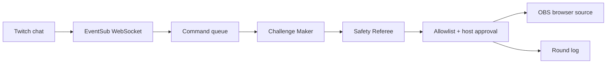

# Haunt My Desk — product brief

## The moment

“Chat just cursed the mug on my desk. I have 30 seconds to break the spell.” A viewer types `!haunt mug` in a real Twitch channel. A seal appears over the actual mug in a fixed camera shot; the host approves a short, safe physical challenge and performs it on camera. The viewer gets credit when the host records the result.

## Audience and need

Small face-cam and desk streamers need lightweight interaction that turns passive chat into something viewers can watch happen. [Streamer discussions](https://www.reddit.com/r/Twitch/comments/1kfb8h7/small_streamers_what_do_you_find_hardest_to_manage_when_no_ones_really_watching/) support the general engagement need. This exact product remains a hypothesis; the hackathon test is whether a stranger understands and reacts to one live round.

## One-round MVP

1. Host opens the control page, connects Twitch, and chooses up to three safe objects.
2. Host drags one anchor for each object onto a preview matching the fixed OBS camera scene.
3. Viewer sends `!haunt <object>` in chat. The command is queued with viewer credit; spam, unknown objects, and duplicate events are ignored.
4. Challenge Maker selects a challenge from a host-approved catalog. Safety Referee independently approves or vetoes the proposed action. An allowlist and host approval gate the overlay. If no API key is available, the interface labels authored challenge mode.
5. Host approves; OBS browser source shows a seal around the object, challenge, and 30-second countdown. Host marks success, failure, or skip. The overlay shows the result.

No camera object detection or automatic physical verification is claimed. The host performs and judges the challenge.

## Architecture

The single Node app serves the host page, OBS overlay, and read-only replay. Browser clients receive state through a local WebSocket. Only the host page can mutate local state; for a remote deployment it must use private admin access.

## Implementation choices

- Node.js 24, TypeScript, Vite for browser assets, `ws` for browser and Twitch WebSockets.
- Twitch OAuth implicit grant on localhost with `user:read:chat`, EventSub `channel.chat.message` for the signed-in broadcaster's channel.
- Optional two distinct OpenAI Responses API calls for challenge selection and safety review; deterministic validation always applies.
- Static 16:9 camera anchors, transparent 1920×1080 overlay; host adjusts anchors during setup.
- JSON round ledger and frozen, explicitly labeled showcase fixture. No viewer data is sold or sent beyond Twitch/OpenAI calls used for the feature.

## Measurable demonstration

One real Twitch command received, one host-approved overlay round, one physical action filmed. Measure command-to-queue and approval-to-overlay latency from local timestamps. Report observed numbers only, never projected engagement or retention.

## Distinction and originality

Existing hackathon patterns such as chat-authored games show audience agency. Our original implementation makes one chat command mark a *real desk object* in the camera shot and invites a visible physical response, with independent safety veto and host control. All code, artwork, and copy are created during this event. Inspiration is a pattern, not reused project code or assets.

## Video arc

0–10s: real Twitch message and seal landing on a mug. 10–55s: setup and approval. 55–100s: one rejected unsafe or unsuitable proposal and recovery. 100–140s: physical challenge and viewer credit. 140–170s: Codex building/fixing the EventSub path, measured latency, repository and live link. Keep final video under three minutes.
