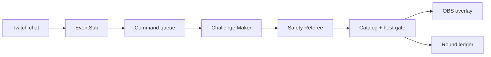

# Haunt My Desk

**Twitch chat curses real objects. The streamer breaks the spell on camera.**

A viewer types `!haunt mug` in a Twitch channel. The host reviews a short physical challenge and approves it. An OBS browser source places an animated seal over the mug in the camera shot and starts a countdown. The streamer performs the challenge, marks the outcome, and gives the viewer on-screen credit.

[Public showcase — labeled simulation](https://saurin16.github.io/haunt-my-desk/) · [Run instructions](app/README.md) · [Demo script draft](06-demo-script.md)

> **Proof status, November 1:** A real `!haunt mug` message from `saurin1602` reached the EventSub queue, two API-backed agents reviewed its catalog challenge, and host approval displayed the overlay with the real sender credited. That round was skipped because no camera action was performed. OBS now composites a live MacBook camera feed with the transparent 1920 × 1080 browser source; a separate, clearly simulated local test showed the animated seal aligned over the real red mug and the challenge card in OBS. That test was also skipped without a physical performance. Seven tests pass. A genuine filmed Twitch-to-camera payoff remains pending.

## Why this interaction

Most chat games change a score, story, or virtual character. Haunt My Desk points at a **real object already visible on the stream** and invites a visible physical response. The camera-anchored effect is the hook. The host keeps control of the approved props, challenge catalog, and final on-stream action.

## What is built

- Twitch OAuth and EventSub WebSocket client for `channel.chat.message` (mock contract and one real channel command verified).
- Complete-command parser, duplicate and cooldown filtering, eight-command queue.
- Challenge Maker and Safety Referee as optional distinct OpenAI Responses API calls. Without an API key, the interface labels authored mode. A deterministic catalog and host approval gate every challenge.
- Host studio with optional camera preview, clickable object anchors, queue, review, and outcome controls.
- Transparent 1920 × 1080 OBS browser source with animated object seal, challenge card, viewer credit, countdown, and result.
- Read-only public showcase with an explicitly simulated fixture.
- Seven passing tests for parsing, filtering, approval, veto/fallback, catalog validation, anchor bounds, and EventSub packet handling.

## Try it

```bash
cd app
npm ci
cp .env.example .env
npm start
```

Open the private host URL printed by the server. Use **Simulate command** for a local check. See [the app README](app/README.md) for Twitch registration, the OBS source, and optional OpenAI setup. The source and assets are in this repository; `.env` and local round data are excluded from Git.

## How it works



## Hackathon progress

- Deadline: November 2, 2026, 2:00 PM PT (internal target noon PT).
- [Rules](00-rules.md) · [Trend scan](01-trend-scan.md) · [Pain evidence](02-pain-points.md) · [Concept comparison](03-concepts-revised.md)
- [Product brief](04-brief.md) · [Build gates](05-build-plan.md) · [Video plan](06-demo-script.md) · [Submission draft](07-submission.md) · [Rubric audit](08-rubric-audit.md)
- Repo: https://github.com/saurin16/haunt-my-desk · Public showcase: https://saurin16.github.io/haunt-my-desk/
- Video: pending real Twitch/OBS recording.

The original code and artwork were created for this event. Earlier projects were used only as inspiration for the audience-participation pattern; no prior project code or assets were copied.
